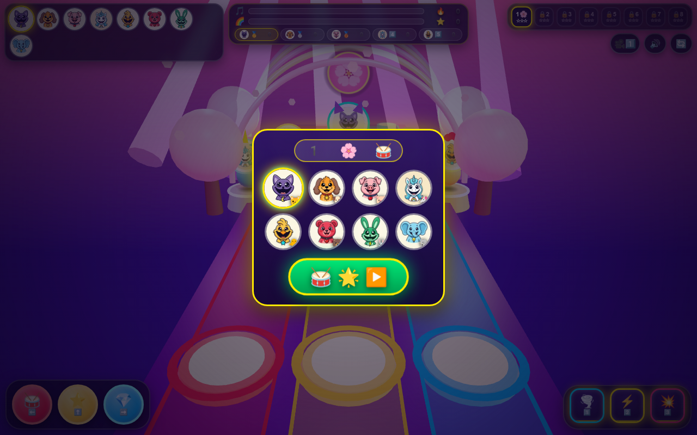

# 🥁 Critter Rhythm Taiko 3D: Starlight Concert Stage! ⭐

**Play Live:** [https://kunruiw1991.github.io/critters-rhythm3d/](https://kunruiw1991.github.io/critters-rhythm3d/)  
**Repository:** [https://github.com/kunruiw1991/critters-rhythm3d](https://github.com/kunruiw1991/critters-rhythm3d)

## 🌟 Overview
**Critter Rhythm Taiko 3D: Starlight Concert Stage!** is a 100% zero-text, kid-friendly 3D WebGL Taiko Drum & Dance Highway Rhythm Game built with **Three.js (r161)** and a procedural **Web Audio API** synthesizer. Pick your favorite Smiling Critter idol (`🐱 🐶 🐷 🦄 🐥 🐻 🐰 🐘`), drum along to 3D glowing drum-notes (`🥁`), star-beats (`⭐`), and multi-hit balloon-rolls (`🎈`) across 8 vibrant concert stages, unleash 3 3D Power Pedals, trigger Rainbow Fever (`🌈`), and finish in the **Top 3** on the 5-Critter Concert Podium!

---

## 🎮 Controls (Desktop Keyboard, Mobile Touch & 3D Raycast)

| Action | Desktop Keyboard | Touch / Mouse Control | 3D Stage Effect |
| :--- | :--- | :--- | :--- |
| **Left Red Taiko Drum (`🥁`)** | `ArrowLeft` / `A` / `J` | Tap Red Pad (`🥁 ⬅️`) or Click 3D Left Drum | Volume-preserving 3D drum squash, red shockwave ring, particle burst & melody note |
| **Center Gold Star Drum (`⭐`)** | `ArrowDown` / `ArrowUp` / `S` / `W` / `K` | Tap Gold Pad (`⭐ ⬇️`) or Click 3D Center Drum | Gold star shockwave, flying Bézier star coins to player idol & harmony chord |
| **Right Blue Gem Drum (`💎`)** | `ArrowRight` / `D` / `L` | Tap Blue Pad (`💎 ➡️`) or Click 3D Right Drum | Cyan/blue shockwave ring, 3D note knock-back flight & high melody note |
| **Pedal 1: Auto-Catch Magnet (`🌪️`)** | `1` / `Numpad1` | Tap `1️⃣ 🌪️` Pedal | Spins a 3D cyan magnetic vortex arch at `HIT_Z` for 3.5s that pulls & auto-perfects notes |
| **Pedal 2: 2x Fever Encore (`⚡`)** | `2` / `Numpad2` / `Space` | Tap `2️⃣ ⚡` Pedal | Transforms the 3D stage arches & lasers into a pulsing HSL rainbow wave with `2x` score for 5s |
| **Pedal 3: Mega Drumroll Blast (`💥`)** | `3` / `Numpad3` | Tap `3️⃣ 💥` Pedal | Blasts the 4 closest approaching notes (`HIT_Z` priority), grants `+20` Fever & stuns all 4 AI rivals |
| **Camera Angle / Sound / Restart** | `Enter` / `Space` (Start / Podium) | Tap `🎥` (`1️⃣..3️⃣`), `🔊/🔇`, `🔄` | Cycles 3 responsive 3D camera presets, toggles Web Audio synth, or restarts the stage |

---

## 🌈 8 Starlight Concert Stages & Top-3 Qualification Rules

- **Top-3 Podium Qualification**:
  - **🥇 1st Place (`⭐⭐⭐`)**, **🥈 2nd Place (`⭐⭐`)**, or **🥉 3rd Place (`⭐`)**: Victory Fanfare, 3D stage fireworks, and unlocks the next concert stage (`▶️`).
  - **4️⃣ 4th Place / 5️⃣ 5th Place (`☆☆☆` / `💔`)**: Sad Defeat screen with sliding Defeat Trombone (`wah-wah-wah-waaah`) and Retry (`🔄`) / Switch Critter (`🎭`) only—next stage remains locked until you place Top 3!

| Stage | Icon | Theme | BPM | Duration | Custom 3D Stage Props |
| :---: | :---: | :--- | :---: | :---: | :--- |
| **1** | `1 🌸` | Sakura Starlight Blossom | 108 | 36s | 4 3D Sakura trees with glowing pink canopies & 28 falling 3D petals |
| **2** | `2 🍭` | Candy Lollipop Carnival | 116 | 38s | 6 giant spinning spiral candy lollipops with candy-striped poles |
| **3** | `3 🌊` | Ocean Coral Lagoon | 122 | 40s | 6 animated 3D ocean wave ribbons & 22 rising translucent sea bubbles |
| **4** | `4 🌴` | Tropical Sunset Oasis | 128 | 42s | 4 curved 3D tropical palm trees with swaying 5-frond crowns |
| **5** | `5 🔮` | Crystal Nebula Cavern | 134 | 44s | 8 levitating, rotating 3D octahedron magic crystals |
| **6** | `6 🌋` | Magma Beat Volcano | 140 | 45s | 4 glowing lava volcano cones with magma rims & 24 rising 3D embers |
| **7** | `7 ❄️` | Frost Aurora Palace | 146 | 46s | 6 translucent 3D ice spires & 26 drifting 3D snowflakes |
| **8** | `8 🌌` | Cosmic Supernova Finale | 154 | 48s | 2 ringed 3D Saturn planets & a 120-star rotating 3D cosmic starfield |

---

## 🛠️ 3D WebGL & Procedural Web Audio Architecture
- **Three.js r161 Physically-Lit Concert Arena**: Uses `ACESFilmicToneMapping`, `SRGBColorSpace`, a cached per-stage `PMREMGenerator` environment lighting map, soft `PCFSoftShadowMap` directional shadows, and upright camera-facing 3D portrait medallions (`icons/*.jpg` with instant `CanvasTexture` emoji pre-seeding and procedural 3D species ears/horns/wings).
- **Zero-Allocation Object Pools**: Pre-allocates 36 3D notes (`drum`, `star`, `balloon`), 12 expanding 3D shockwave rings, a 160-instance `THREE.InstancedMesh` particle burst pool, and a 48-instance `THREE.InstancedMesh` quadratic Bézier flying star-coin pool (`renderer.info.memory.geometries` stays constant across stage restarts).
- **Procedural Web Audio Synthesizer (`SoundEngine`)**: Synthesizes stage launch sweeps, pitch-scaled critter selection chimes, lane-tuned Taiko drum hits with Star shimmer and Balloon pop/boing overtones, Rainbow Fever 6-note arpeggios, power pedal chords, victory fanfares, and a pitch-sliding `sawtooth` defeat trombone with zero external audio files.

---

## 🔄 10-Round Critic-Creator Iterative Refinement Changelog
1. **Round 1 (3D WebGL Scene Architecture, Lighting/Shadows & Asset Loading)**: Added `fitCameraToViewport()` for desktop/mobile portrait/short-landscape framing, `ACESFilmicToneMapping` with `toneMapped: false` on unlit color-identity materials, `PMREMGenerator` stage IBL caching, `PCFSoftShadowMap` + blob shadows, and instant `CanvasTexture` fallback seeding on `THREE.LoadingManager`.
2. **Round 2 (8 Smiling Critters Picker, Upright 3D Portrait Medallions & 8 Stage Themes)**: Added pre-song 8-critter radio grid card + podium `🎭` switcher, elevated upright camera-billboarded 3D portrait medallions (`y=2.38, z=0.82`) with procedural 3D ears/horns/wings and minimum screen-space clamping (`>=46px`), and built 8 distinct 3D stage prop sets (`stagePropGroups[0..7]`) with ΔE-separated sky gradients.
3. **Round 3 (Core 3D Physics & Tactile Collision Impact)**: Replaced position-jitter camera shake with post-`lookAt` `trauma²` rotational shake + harmonic spring kicks, added volume-preserving 3D drum pad squash springs (`scaleXZ = 1 - 0.5*squashY`), 3D note knock-back flight & balloon recoil, expanding 3D shockwave rings, 160-instance `InstancedMesh` particle bursts, and 48-instance `InstancedMesh` quadratic Bézier flying star coins to `idolActors[0].headBillboard`.
4. **Round 4 (100% Zero-Text Kid-Friendly Visual Cockpit)**: Styled `.pad-ring` and live `.note-ready` drum pad hit-window highlights, enlarged mobile touch targets with distinct `.ready` / `.on-cooldown` / `.active-buff` pedal states, and removed all English `title` attributes.
5. **Round 5 (3 Interactive Power Pedals & Rainbow Fever Mode `🌈`)**: Added real-time 3D HSL rainbow wave stage transformation during Rainbow Fever (`neonArches`, `laserBeams`, `drumZoneLight`, `laneStrips`), persistent 3D `magnetVortexGroup` aura + magnetic note pull for Pedal 1 (`🌪️`), and closest-to-`HIT_Z` sorting, 3-lane shockwaves, and `+20` Fever boost for Pedal 3 (`💥`).
6. **Round 6 (4 AI Rivals Behavior & Kid-Friendly Difficulty Calibration)**: Calibrated Stage 1–8 `rivalRate` (`68..168`) with mercy rubber-banding on Stages 1–3, added multi-frequency lead-swapping rhythm waves and beat-synced rival hop bursts, and added dynamic 3D rival pedestal ring status colors (Gold Leader `#ffea00` vs. Stunned Magenta/Red `#ff1744`).
7. **Round 7 (Strict 5-Critter Podium & Top-3 Qualification Rules)**: Added distinct `.victory-card` vs `.defeat-card` podium frames, separated `.qualified-step` (`⭐⭐⭐`/`⭐⭐`/`⭐`) from `.eliminated-step` (`💔`) plinths, added 3D victory fireworks vs defeat wobble in `finishStage()`, and wired `Enter`/`Space` podium shortcuts.
8. **Round 8 (Procedural Web Audio Synths & Responsive Viewport Layout)**: Added `playStageLaunch()`, `playFeverChime()`, Star/Balloon hit overtones in `playDrumHit()`, and a pitch-sliding `sawtooth` Defeat Trombone in `playFanfare(false)`, plus single-row mobile portrait HUD rails, short-landscape podium compaction, and `clamp()` cockpit pad/pedal sizing.
9. **Round 9 (End-to-End Gameplay Polish, Pool Hygiene & Documentation)**: Fixed `spawnShockwaveRing` positional arguments in `finishStage()` and `state.patternStep` rival hop indexing, added full pool/visual reset hygiene in `startStage()` (`particlePool`, `laneFlashTimers`, `drumTargets`, `fxLayer`, `orientationchange`), and expanded `README.md`.
10. **Round 10 (Final Headless Chrome Verification, Screenshot Capture & GitHub Pages Deployment)**: Verified live rendering on port `8906`, captured `1280x800` `screenshot.jpg`, and deployed to `https://kunruiw1991.github.io/critters-rhythm3d/`.
